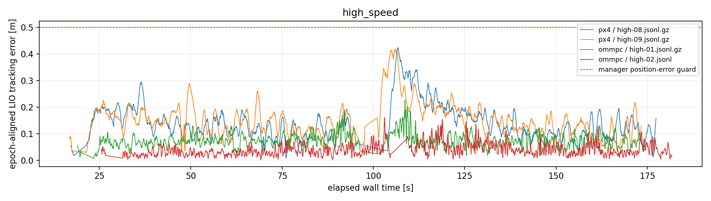

# OMMPC / PX4 controller comparison — 2026-11-05

[실행 안내](../../ommpc-forest-comparison.md). 기존 PX4 원시 기록은 `../zav-forest-20261105/`에 보존한다. 실제 Isaac ZAV / MID360 / FAST-LIVO / SUPER / PX4 SITL을 사용했다. 공개 OMMPC 코어 commit `29cf38acf6a9a6fb9627c189d6e66afbcc605244`, OSQP 0.6.3이다.

## high_speed, 계획 2m/s, 원본 200m 왕복

| 실행 | 제어기 | 이동 RMS | P95 | 최대 오차 | 전체 검사 |
|---|---|---:|---:|---:|---|
| high-08 | px4 | 15.49cm | 27.85cm | 42.43cm | PASS |
| high-09 | px4 | 16.29cm | 26.27cm | 41.92cm | PASS |
| high-01 | ommpc | 7.78cm | 11.51cm | 22.67cm | PASS |
| high-02 | ommpc | 4.54cm | 8.14cm | 16.10cm | PASS |

`high-01`은 초기 연결 버전, `high-02`는 실제 LIO 측정 시각에 맞춰 reference 평가를 보강한 버전이다. 두 OMMPC 실행 모두 정상 왕복·착륙/disarm, 접촉 0, 원본 XY 범위 유지, 이동 중 OMMPC/body-rate authority 100%였다. `high-02`의 실제 최고 속도는 약 2.07m/s, 나무 표면 거리 하한 1.284m, MPC 계산 최대 약 2.00ms였다. [전체 수치](high-comparison.json).

이 시험들은 기존 R270/H250 원통 충돌체와 같은 플래너 YAML 조건이다. 이후 사용자 치수에 맞춘 hull/팽창 변경은 [별도 시험](../zav-footprint-20261105/README.md)으로 구분한다. 시각 정렬 지표는 모든 명령을 읽은 뒤 측정 시각에서 보간했으며 reference 속도 0.2m/s 이상 구간을 집계했다. 경로가 동일하지 않고 최종 시각 보강 버전의 반복 수가 적으므로 통계적 우월성이나 8/25m/s 재현으로 해석하지 않는다.

## dense 및 중간 실패

- smoke-01: 출력 메시지의 NumPy float 변환 문제로 실패, 정상 착륙/disarm. 변환 및 회귀 검사 추가.
- smoke-02: 신규 로그의 float32 JSON 변환 문제로 실패, 정상 착륙/disarm. 로그 형변환 수정.
- smoke-03: 5m 왕복과 착륙 통과. 원본 전체 임무와 구분한다.
- dense-01: 초기 시각 처리 버전, 국소 경로 반복으로 약 187초에서 중단, 정상 착륙/disarm.
- dense-02: PX4 준비 전에 이륙 요청이 거절돼 지상에서 종료. OMMPC 추종이 시작되지 않았다. 시험기가 PX4 preflight-ready를 기다리도록 보강했다.
- dense-03: 측정 시각 정렬 버전, yaw rate 상한 1.5rad/s. 경로 반복 중 ENU/NED 방위각 보호로 중단, 정상 착륙/disarm.
- dense-04: yaw rate 상한 1.0rad/s로 제한해 재시험. 국소 경로 반복/탐색 실패가 남았으며 사용자 경로 진동 점검 요청을 받아 중단, 정상 착륙/disarm.

**dense 전체 왕복은 아직 미통과다.** OMMPC가 추종 오차를 줄여도 A* 경로 전환·회랑 실패를 자동으로 해결하지 않는다. `../frontend-route-memory-20261105/off-01.jsonl.gz`는 같은 yaw 상한에서 목표당 180초인 기존 경로 선택 조건의 비교 기록이며, 경로 유지 ON 시험은 아직 없다.

## 검증

Python 기능 검사 37개, SUPER C++ 6개, 공개 OMMPC 호버 QP/sign 검사 1개가 통과했다. 테스트 결과와 현재 코드 hash를 함께 저장한다. 실제 기체에는 적용하지 않았다. 기존 watchdog/위치·방위각 보호를 완화하지 않았다.
