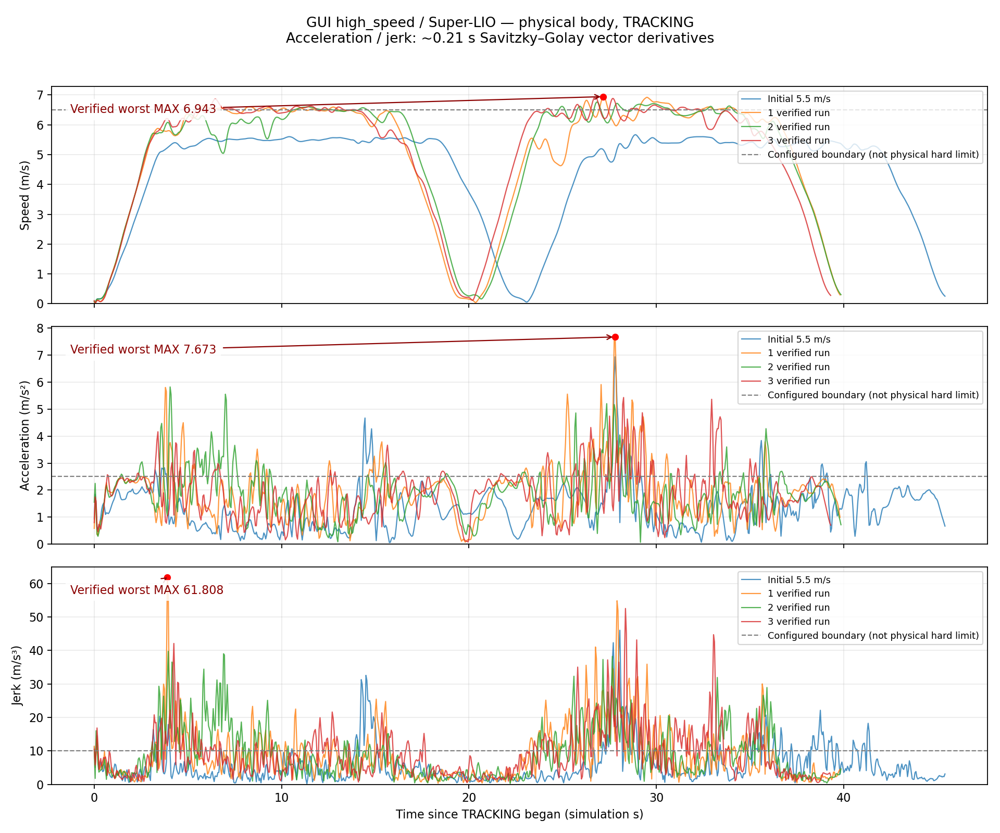

# high_speed + Super-LIO 패널티 튜닝 — 2026-11-13

최종 채택: **`balanced_smooth-v65`**, 새 Isaac Sim GUI + RViz2 세션 **3회 연속 검증 통과**. 이 머신의 고정 high_speed 왕복에서 시험한 조합 중 반복 검증을 통과한 가장 빠른 조합이며, 연속 파라미터 공간의 전역 최적값을 증명한 것은 아니다.

기준은 이번 요청 시점의 양수 exp jerk/attract 및 backup jerk 설정이다. 이전 음수 패널티 시험을 기준으로 섞지 않았다. 최종 설정에서 OMMPC·Super-LIO 알고리즘·지도·기체 형상·온보드 안전 임계값은 변경하지 않았다. 주로 패널티를 비교하고 속도/가속도/저크 boundary를 단계적으로 올렸다. 보조 비교로 각속도 한계와 MPC 20ms 주기를 각 1회 시험했지만 채택하지 않고 원복했다.

## 최종 boundary

```yaml
boundary:
  max_vel: 6.5
  max_acc: 2.5
  max_jerk: 10.0
  max_omg: 1.2
  max_acc_thr: 20
  min_acc_thr: 6.0
  penna_margin: 0.05
```

## 패널티 설정

일괄 축소가 아니라 시간 비용과 동역학·경로 벌점의 상대 크기를 비교했다. 최종 조합은 여러 항을 함께 바꾼 실험이므로 개별 항의 독립적인 인과 효과를 확정하지 않는다.

### exp_traj

| 항목 | 처음 값 | 최종 값 |
|---|---:|---:|
| penna_t | 1e+08 | **3e+07** |
| penna_pos | 5e+08 | **1e+09** |
| penna_vel | 5e+08 | 5e+08 |
| penna_acc | 5e+08 | 5e+08 |
| penna_jerk | 5e+11 | **1e+10** |
| penna_attract | 1e+07 | **100000** |
| penna_omg | 5e+08 | 5e+08 |
| penna_thr | 5e+08 | 5e+08 |

### backup_traj

| 항목 | 처음 값 | 최종 값 |
|---|---:|---:|
| penna_t | 1e+06 | **300000** |
| penna_ts | 1e+07 | **3e+06** |
| penna_pos | 1e+10 | 1e+10 |
| penna_vel | 1e+08 | **5e+08** |
| penna_acc | 1e+08 | **5e+08** |
| penna_jerk | 1e+08 | **1e+10** |
| penna_omg | 5e+08 | 5e+08 |
| penna_thr | 5e+08 | 5e+08 |

## 새 세션 반복 검증

| 실행 | 추종 sim s | 벽시계 s | 실제 최고 / p95 m/s | 최고/설정 | 실제 acc / jerk 최대 | LIO 최대 m | 여유 하한 m |
|---|---:|---:|---|---:|---|---:|---:|
| [verify-balanced_smooth-v65-1](verify-balanced_smooth-v65-1/evaluation.json) | 39.80 | 41.49 | 6.943 / 6.703 | 1.068 | 7.673 m/s² / 61.808 m/s³ | 0.352 | 0.376 |
| [verify-balanced_smooth-v65-2](verify-balanced_smooth-v65-2/evaluation.json) | 39.80 | 41.47 | 6.765 / 6.623 | 1.041 | 5.821 m/s² / 39.720 m/s³ | 0.414 | 0.686 |
| [verify-balanced_smooth-v65-3](verify-balanced_smooth-v65-3/evaluation.json) | 39.20 | 40.85 | 6.930 / 6.624 | 1.066 | 5.430 m/s² / 52.515 m/s³ | 0.565 | 0.662 |

현재 기준 탐색 비행: 45.30 sim s, 실제 최고 5.667m/s. 기준 설정의 별도 3회 평균은 45.61 sim s. 최종 3회 평균 39.60 sim s, 범위 39.20–39.80s. 평균 기준 시간 단축 13.2%. 이륙·착륙 시간은 제외하고 회항·계획 대기를 포함한 TRACKING 구간이다.

최고 속도만 짧게 찍은 결과와 구분하기 위해 실제 속도의 95백분위, 설정 대비 달성률, 설정 90% 이상 비행한 표본 비율도 각 evaluation.json에 저장했다. 최종 후보의 매 반복에서 peak/설정 ≥0.9, p95/설정 ≥0.85, peak/설정 ≤1.15를 요구했다. 설정 15m/s에 실제 5m/s인 조합은 이 기준으로 채택할 수 없다.

acc/jerk 값은 물리 기체의 body 원점 속도 벡터를 약 0.21초 평활 미분한 실측치다. nominal boundary와 같지 않으며 표에 실제 초과량을 숨기지 않았다. reference 궤적의 analytic 최대값은 각 metrics.json에 별도로 저장했다.



## 판정과 재현

- Isaac Sim GUI + RViz2를 모두 실행하고 매 trial마다 새 simulator를 시작했다. 중간 GUI 화면·window tree를 보관했다.
- physical ground truth는 진단·시험 중단 판단에만 사용하고 계획·제어에는 주입하지 않았다. controller mode는 rate-only인지 독립 확인했다.
- 중도 착륙/FAULT/STOPPED, 미완주, 물리 목표 미도달은 순위에서 제외했다. 두 목표의 실제 위치 오차 0.8m 이하, 최종 정상 착륙·disarm을 요구했다.
- 사용자가 정상 완주·충돌 여유를 우선하고 위치 오차를 함께 보고하도록 선택했다. 따라서 기존 LIO 최대 오차 0.5m/RMS 0.25m는 최종 탈락 기준으로 사용하지 않았다. odom 최대 stamp 공백 50ms 이하·수신 공백 200ms 이하와 기존 온보드 보호는 유지했다.
- 실제 body 중심 선분을 1cm 이하 간격으로 검사한 PCD 거리에서 body 반경 0.33m·복셀 재구성 상한 0.086603m·선분 반간격 0.005m를 빼고 여유 하한 0.1m 이상을 요구했다. 장애물 KDTree에서는 지면을 제외하고, 주행 중 body 최소 높이에서 0.33m를 뺀 지면 여유도 별도로 0.1m 이상인지 검사했다. 음수는 보수적 무접촉 입증 실패이며 PhysX 접촉을 직접 센 결과가 아니다.
- 단발 통과 후보를 빠른 순서대로 다시 3회 검증했다. 사용자의 기준 변경 전에 위치 오차 2m로 진단 중단한 시험은 새 기준에서 미완료 탐색으로 구분한다. 이후에는 위치 오차만으로 시험을 종료하지 않고 실제 시나리오 이탈·기존 온보드 보호·미완주·물리 목표 미도달·충돌 여유 부족을 확인했다. 모든 실패와 중단 기록을 보존했다.

```bash
./run_super_sim.sh high_speed
# 다른 터미널
./run_super.sh --scenario high_speed --backend super_lio --execute
# 종료 후 실제 움직임 그래프
./show_super_flight.sh
```

적용 파일은 `src/zav_super/config/high_speed_super_lio.yaml` 및 동일한 install 복사본이다. 기존 명령은 그대로이며 dense·다른 LIO 프로파일은 바꾸지 않았다.

## 전체 탐색 기록

실패한 비행의 부분 시간·순간 최고속도는 완주 성능으로 제시하지 않는다. 진단용 상세 숫자는 각 evaluation.json에서 확인할 수 있다.

| 시험 | v / a / j | 완주·여유 통과 | 순위 대상 시간 s | 실제 최고 m/s | 이유 |
|---|---|---|---:|---:|---|
| [baseline-positive](baseline-positive/evaluation.json) | 5.5/2.0/8.0 | True | 45.30 | 5.667 | 통과 |
| [original-v65](original-v65/evaluation.json) | 6.5/2.5/10.0 | False | — | — | 기준 변경 전 위치오차 진단 중단 |
| [relaxed_jerk-v65](relaxed_jerk-v65/evaluation.json) | 6.5/2.5/10.0 | False | — | — | FAULT: SUPER trajectory heartbeat expired |
| [smooth_constraints-v65](smooth_constraints-v65/evaluation.json) | 6.5/2.5/10.0 | False | — | — | 기준 변경 전 위치오차 진단 중단 |
| [time_pressure-v65](time_pressure-v65/evaluation.json) | 6.5/2.5/10.0 | False | — | — | FAULT: SUPER trajectory heartbeat expired |
| [balanced_smooth-v65](balanced_smooth-v65/evaluation.json) | 6.5/2.5/10.0 | True | 41.15 | 6.746 | 통과 |
| [route_fidelity-v65](route_fidelity-v65/evaluation.json) | 6.5/2.5/10.0 | False | — | — | FAULT: SUPER trajectory heartbeat expired |
| [backup_smooth-v65](backup_smooth-v65/evaluation.json) | 6.5/2.5/10.0 | False | — | — | 기준 변경 전 위치오차 진단 중단 |
| [time_pressure_exp-v65](time_pressure_exp-v65/evaluation.json) | 6.5/2.5/10.0 | True | 39.80 | 6.762 | 통과 |
| [winner-v8](winner-v8/evaluation.json) | 8.0/2.5/10.0 | False | — | — | 기준 변경 전 위치오차 진단 중단 |
| [winner-v725](winner-v725/evaluation.json) | 7.25/2.5/10.0 | False | — | — | 물리 충돌 여유 기준 미달 |
| [balanced-v8](balanced-v8/evaluation.json) | 8.0/2.5/10.0 | False | — | — | 기준 변경 전 위치오차 진단 중단 |
| [balanced-v725](balanced-v725/evaluation.json) | 7.25/2.5/10.0 | True | 38.10 | 7.470 | 통과 |
| [balanced-v75](balanced-v75/evaluation.json) | 7.5/2.5/10.0 | True | 40.70 | 7.823 | 통과 |
| [verify-balanced-v725-1](verify-balanced-v725-1/evaluation.json) | 7.25/2.5/10.0 | False | — | — | 기준 변경 전 위치오차 진단 중단 |
| [verify-time_pressure_exp-v65-1](verify-time_pressure_exp-v65-1/evaluation.json) | 6.5/2.5/10.0 | False | — | — | FAULT: SUPER trajectory heartbeat expired |
| [verify-balanced_smooth-v65-1](verify-balanced_smooth-v65-1/evaluation.json) | 6.5/2.5/10.0 | True | 39.80 | 6.943 | 통과 |
| [verify-balanced_smooth-v65-2](verify-balanced_smooth-v65-2/evaluation.json) | 6.5/2.5/10.0 | True | 39.80 | 6.765 | 통과 |
| [verify-balanced_smooth-v65-3](verify-balanced_smooth-v65-3/evaluation.json) | 6.5/2.5/10.0 | True | 39.20 | 6.930 | 통과 |
| [verify-baseline-positive-1](verify-baseline-positive-1/evaluation.json) | 5.5/2.0/8.0 | True | 45.69 | 5.723 | 통과 |
| [verify-baseline-positive-2](verify-baseline-positive-2/evaluation.json) | 5.5/2.0/8.0 | True | 45.25 | 5.655 | 통과 |
| [verify-baseline-positive-3](verify-baseline-positive-3/evaluation.json) | 5.5/2.0/8.0 | True | 45.89 | 5.640 | 통과 |
| [balanced-v725-omg06](balanced-v725-omg06/evaluation.json) | 7.25/2.5/10.0 | False | — | — | 기준 변경 전 위치오차 진단 중단 |
| [balanced-v8-mpc02](balanced-v8-mpc02/evaluation.json) | 8.0/2.5/10.0 | False | — | — | 기준 변경 전 위치오차 진단 중단 |
| [completion-balanced-v8](completion-balanced-v8/evaluation.json) | 8.0/2.5/10.0 | False | — | — | FAULT: SUPER trajectory heartbeat expired |
| [completion-balanced-v725](completion-balanced-v725/evaluation.json) | 7.25/2.5/10.0 | False | — | — | 물리 충돌 여유 기준 미달 |
| [final-completion-balanced-v75-1](final-completion-balanced-v75-1/evaluation.json) | 7.5/2.5/10.0 | False | — | — | 물리 충돌 여유 기준 미달 |

## 원본 기록

[전체 결과](summary.json) · [완주 우선 반복 검증·선정](verification.json) · [이전 정확도 기준 검증](verification-previous-strict.json) · [사용자 선택 기준](selection-policy.json) · [시작 파일 해시](initial-hashes.json) · [권장 설정 전체](recommended.yaml). 각 trial의 telemetry 폴더에 report.html, motion.png, kinematics.csv, samples.jsonl 및 실제 사용한 planner metadata가 있다. flight.jsonl/odom-events.jsonl은 독립적인 위치·수신 품질 진단이다. 로그는 로컬 *.log로 남아 있다.
