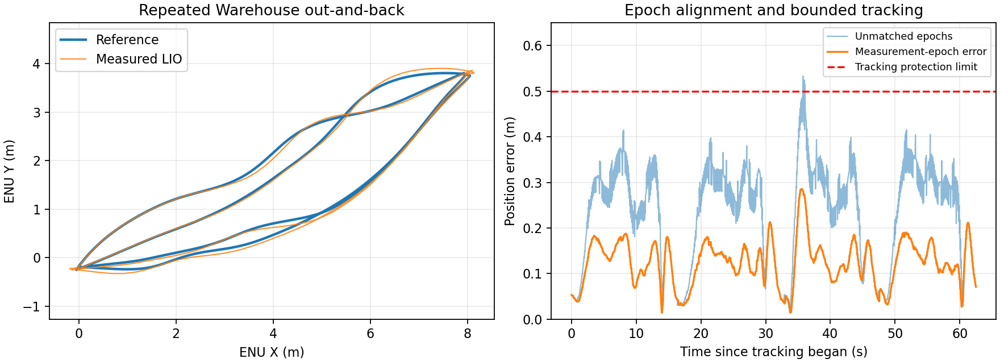

# SUPER–PX4 Warehouse SITL 안정화 검증 — 2026-11-05

현재 Warehouse SITL과 기본 자율비행 프로파일(최대 속도 1m/s, 가속도 1m/s²)에서
정의한 추종·복구·안전 중단 검증을 통과했다. 실제 PX4 SITL과 Isaac Sim을 반복
이륙·비행·착륙시켰으며, 최종 시험 후 landed=true, armed=false를 직접 확인했다.
시험용 프로세스는 종료했다. 실기체·바람·다른 맵에 대한 인증 결과는 아니다.

[기계 판정 결과](acceptance.json), [전체 시험 요약](summary.json),
[최종 지상 상태](final-ground-state.json), [실행 가이드](../../super-px4-tracking.md)

## 최종 통과 결과

| 시험 | 결과 |
|---|---|
| normal-13: 3m 사각 경로, 4개 목표 | 모두 도달, 정상 착륙 |
| normal-14: (8m,4m) 왕복 두 번, 4개 목표 | 모두 도달, 정상 착륙 |
| height-15: 수평 2m 이동과 높이 ±0.5m, 2개 목표 | 모두 도달, 정상 착륙 |
| recovery-07: backup 생성 후 재계획 실패 10회 주입 | 실제 backup 실행 → 정지 → 같은 목표 재계획 → 두 목표 도달 → 착륙 |
| planner-stop-09: 플래너 프로세스 일시 중단 | 약 0.291초 뒤 추종 차단, 정지 유지, 재개 후 자동 재출발 없음, 착륙 |
| lio-stop-10: FAST-LIVO 프로세스 일시 중단 | 약 0.211초 뒤 추종 차단, 정지 유지, 재개 후 자동 재출발 없음, 착륙 |
| manual-stop-11: Space 정지 | 즉시 차단, 정지 유지, 착륙 |
| safety-land-12: 모니터 사본에 3m LIO 점프 주입 | 실제 점프 latch → baro 전환 확인 → 자동 NAV_LAND → 지상·disarm |

정상 반복 시험 3회에서 총 10개 목표를 도달했다. 측정 시각을 맞춘 위치 오차의
최대값은 **0.302m**, 각 시험 RMS는 **0.134~0.169m**였다. 제어용 현재 시각
예측 오차의 최대값은 0.321m였다. 목표 도달 시 위치 오차는 최대 **0.141m**였다.
플래너 명령은 약 **50Hz**, 최종 정상 시험의 최대 명령 간격은 **22.94ms**였다.
추종 차단 한계 0.5m와 기존 수신·안전 임계값은 유지했다.



C++ 실행·복구·최적화 테스트 3개, FAST-LIVO IMU 버퍼 테스트 1개,
Python 추종·제어 타이머·안전 테스트 25개가 통과했다.

## 수정한 결함

1. 현재 시각 목표와 약 0.2초 지연된 LIO 위치를 직접 비교하던 문제를 고쳤다.
   플래너의 보호 검사는 측정 시각의 기준 궤적과 비교한다. flight_manager는
   유효한 child-frame 속도를 world로 회전하고 제한된 시각 차이 내에서 위치를
   예측해 제어 명령 시각과 맞춘다. 원래 stamp를 바꾸거나 보호 한계를 늘리지 않았다.
2. ROG-Map이 odometry의 속도를 RobotState에 전달하지 않아 정지 gate가
   초기화되지 않은 값을 사용하던 문제를 고쳤다. 두 type_utils 헤더의 RobotState
   정의를 하나로 통일하고, pose·속도·측정 시각을 일관된 잠금 snapshot으로 전달한다.
3. FAST-LIVO IMU 전파가 대기 버퍼의 마지막 가속도를 긴 dt 전체에 적용하던
   문제를 고쳤다. 각 IMU 샘플을 자기 시간 간격으로 적분하고 EKF 수정 후에는
   해당 시각 뒤의 샘플만 다시 적분한다. 초기 착륙 접촉에서 관찰된 큰 점프는
   수정 후 정상 착륙 반복에서 재발하지 않았다.
4. flight_manager와 플래너의 실행 허용을 연결했다. mode 2, armed, flying,
   제어 허용, 비차단 상태에서만 실행을 허용한다. 착륙·수동 전환·안전 차단 때
   이전 목표를 함께 취소해 유령 계획이나 의도하지 않은 자동 재출발을 막는다.
5. 기본 비활성인 SITL 전용 유한 실패 예산을 추가해 실제 committed/backup
   실행을 검증했다. 정상 실행에는 주입하지 않으며 테스트 모드는 읽기 전용
   시작 옵션이다.

## 실패 기록도 보존

- baseline-01: 네 목표는 도달했으나 착륙 접촉 때 IMU 전파 점프가 검출됐다.
  초기 드라이버의 PASS는 전체 안정화 합격으로 사용하지 않는다.
- aligned-03: 세 목표 도달 뒤 baro aid 상태 수신 공백으로 READY가 잠시 내려가
  안전 정지했다. 점프 latch는 없었고 정상 착륙했다. 신선한 OFF 증명이 없으면
  중단하는 기존 정책은 유지했다. 최종 정상 반복에서는 이 공백이 재발하지
  않았고, baro 상태의 최대 수신 간격은 약 0.144초였다. 통신·부하 조건이 달라져
  증명이 다시 끊기면 자동 비행은 계속 진행하지 않고 안전 차단한다.
- recovery-04, planner-stop-08: 검증 드라이버의 이전 상태 처리/로그 인자 오류로
  조기 착륙한 무효 시험이다. 드라이버를 수정했고 후속 실제 시험으로 재검증했다.
- recovery-05/06: 실패 시 기존 궤적 유지와 정지 후 재계획은 성공했지만,
  실패 주입 시점에 backup이 없어 **backup 검증은 불합격** 처리했다.
  backup 생성 확인 후 실패를 넣는 recovery-07에서 실제 backup 실행을 검증했다.

## 재현

시뮬레이터, FAST-LIVO, 추종 replanner를 실행하고 다른 flight_manager를 종료한다.
다음 드라이버가 실제 manager를 생성해 이륙·mode 2·목표·착륙을 제어한다.
로컬 PX4와 zav_sim 프로세스 및 단일 PX4 publisher를 확인하고 기존 로그는 덮어쓰지 않는다.

```bash
source simulator/environment.sh
source /opt/ros/humble/setup.bash
source install/setup.bash
python3 simulator/tools/runtime/check_super_tracking.py --sitl \
  --offsets '3,0;0,3;-3,0;0,-3' --log /tmp/super-new-run.jsonl
```

backup 주입 검증에만 launch의 `enable_sitl_test_hooks:=true`와 드라이버의
`--fail-replans 10 --inject-when-backup --require-recovery`를 사용한다.
LIO 점프 시험에는 FAST-LIVO의 `safety_experiment:=True`가 필요하다.
모니터 사본만 변조하며 가짜 `/fmu` 상태나 가짜 PX4 odometry를 발행하지 않는다.

```bash
python3 simulator/tools/runtime/summarize_super_tracking.py \
  docs/validation/super-stability-20261105
```

시험 중 시뮬레이터는 ROS domain 119를 사용했다. 모든 참여 노드는 같은 domain이어야 한다.
