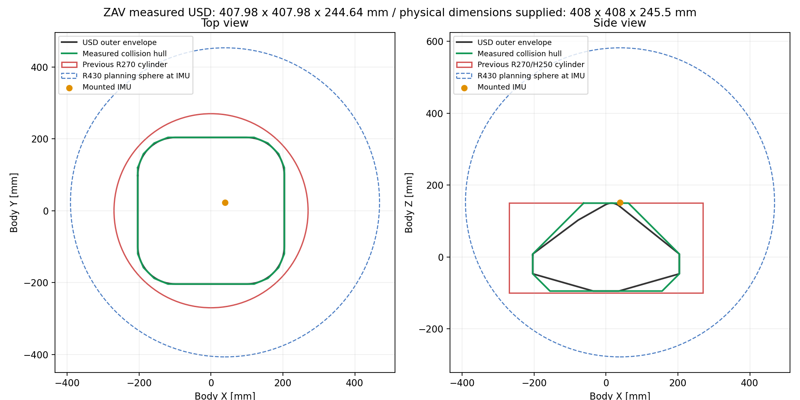

# ZAV footprint / inflation audit — 2026-11-05

[해석과 재현 절차](../../zav-footprint-audit.md)

- [기체/충돌체 실측](geometry-audit.json): 실물 408×408×245.5mm, USD 407.978×407.978×244.636mm. 593개 메시 전체를 확인했다.
- [ROG-Map 오프라인 진단](inflation-audit.json): 원본 전체 점군을 사용하는 별도의 진단이며 실제 비행 입력은 계속 FAST-LIVO다.
- [실측 형상 비행 독립 검사](flight-report.json): 전체 임무 FAIL, 착륙 중 접촉 포함.
- [같은 OMMPC의 기존/새 조건 비교](flight-comparison.json): 반경 0.43m, 160초 동일 시점의 진행과 시각 정렬한 추종 오차.
- [중단 단계 검사](abort-phase-analysis.json): 보호 착륙 전 접촉 0회, 표면 거리 하한 0.459m. 이후 착륙 구간에서 접촉 발생.
- `stalled-corridor-snapshot.json`은 착륙 후 국소 시각화 범위가 seed 높이를 포함하지 않아 clearance 판단에서 **제외**했다.

이번 시험은 경로 유지 옵션을 사용하지 않았다. 과보수적인 모델링을 줄여도 회랑 실패가 남았다. 해당 입력 지연은 아래 사용자 설명에 따라 외부 시각화 부하로 구분한다. 이 설정을 전체 안정화 완료로 채택하지 않는다. 모든 시험 기체는 최종 landed/disarm을 확인했다.

사용자 후속 설명에 따라 입력 지연 보호 착륙은 collision 확인 표시로 인한 외부 연산 부하로 분류한다. OMMPC 자체 결함으로 집계하지 않으며 원시 사건 기록은 유지한다.
