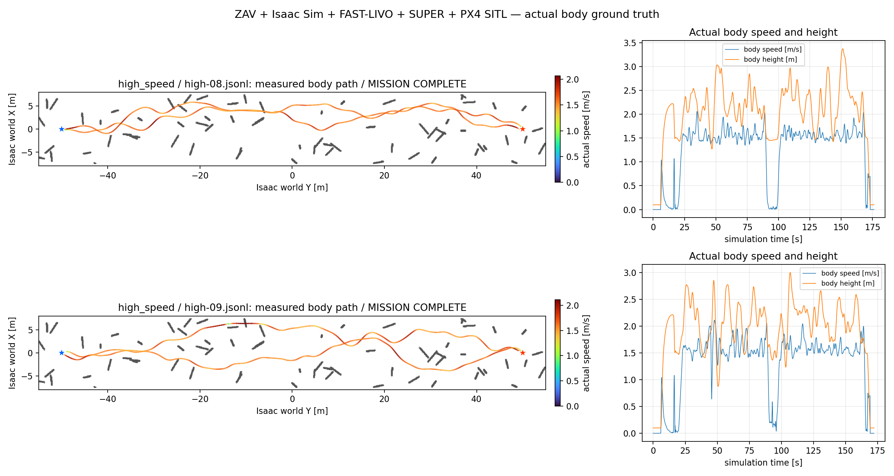
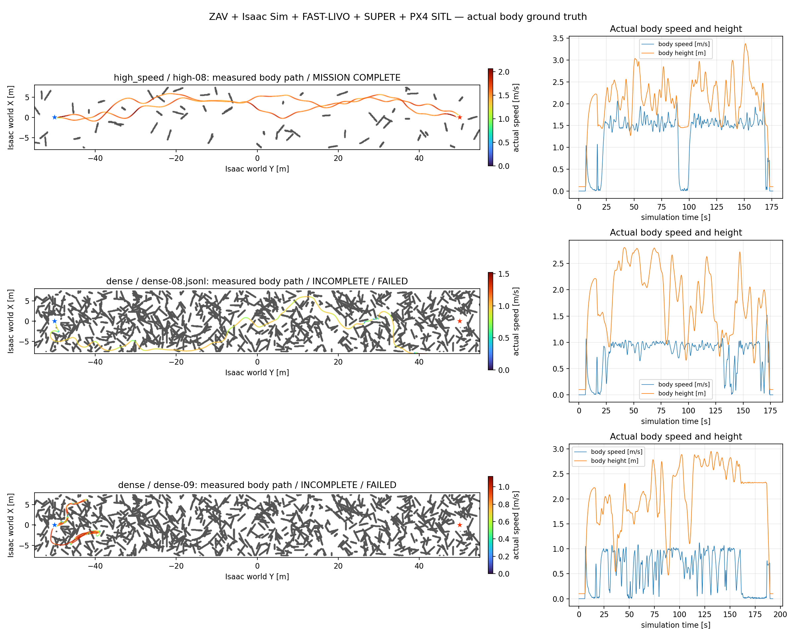

# 실제 ZAV / FAST-LIVO / PX4 공식 숲 시험 — 2026-11-05

이 폴더는 공식 `perfect_drone_sim` 실행 기록과 별개다. 실제 `simulator/zav_sim.py`의 ZAV 동역학·MID360·RGB·IMU, `./run_fastlivo.sh`, ZAV SUPER replanner와 실제 flight_manager/PX4 SITL을 연결했다. 원본 `(0,-50,1.5)` → `(0,50,1.5)` → `(0,-50,1.5)` 목표를 사용한다. 첫 목표는 지상 이륙 후 원본 공중 시작 고도로 진입하는 단계다.

[직접 실행 절차](../../zav-forest-benchmarks.md)

## 시험에서 발견해 수정한 문제

1. **카메라 FOV로 잘린 지도 입력**: `camera:=True`에서 `/cloud_registered`는 카메라 안에 들어온 RGB 점만 발행한다. 360° LiDAR 전체 점군이 아니었다. 복귀 중 뒤쪽 나무를 지도에 반영하지 못해 high-05에서 실제 PhysX 나무 접촉이 발생했다. RGB 토픽을 유지하고, deskew된 전체 LiDAR 점군 `/cloud_registered_full`을 별도 발행해 숲 플래너의 입력으로 사용했다. 관측 시각은 실제 LIO update epoch다.
2. **지연/미래 odometry 비교**: 숲 시험에서 지도용 mapped odometry의 지연과 수신 공백이 기존 0.3초 시간 보호를 넘었다. 추종과 로봇 상태에 실제 FAST-LIVO IMU 전파 odometry를 사용한다. IMU 콜백이 20Hz `/clock`/명령보다 앞설 수 있으므로 버퍼에서 명령 시각 이전의 가장 최신 실측 상태를 선택한다. stamp를 바꾸거나 시간 보호/0.5m 추종 오차 한계를 늘리지 않았다.
3. **숲 밖 우회**: Warehouse용 sliding 50m 정사각 지도로 실행하면 원본 폭 15m 숲 바깥으로 우회할 수 있었다. 원본처럼 110m × 15m 고정 지도를 LIO 좌표에 적용한다. 숲 밖 우회 비행은 통과로 세지 않는다.
4. **작은 회랑 box**: 기존 1m corridor bound에서는 약 31m 지점에서 회랑 overlap 실패로 멈췄다. high-speed 원본과 같은 3m box를 사용해 주변 공간에서 회랑을 찾도록 했다. ZAV 기체 반경 0.43m와 inflation은 유지한다.
5. **A*와 회랑 반경 불일치**: 기본 map inflation 0.4m가 CIRI robot radius 0.43m보다 작아, A*가 선택한 seed line의 장애물 거리 0.384m를 CIRI가 거부했다. high-06에서 무접촉 정지로 확인했고 map inflation을 0.6m로 늘려 frontend와 회랑 조건을 맞췄다.
6. **시험 종료 시 ROS shutdown 순서**: 기본 rclpy SIGINT 처리로 context가 먼저 종료되면 finally의 착륙 명령이 실패할 수 있었다. 시험 드라이버는 rclpy 자동 signal shutdown을 사용하지 않고 Python interrupt를 받아 context가 살아 있는 동안 정상 착륙·disarm을 기다린다. high-04 중단에서 실제 정상 착륙을 확인했다. high-03은 별도 정상 NAV_LAND 요청 후 landed/disarm을 확인했다.

정적 지도 경로도 원본과 비교해 수정했다. 공식 benchmark는 raycasting을 끄지만 기존 Warehouse 프로파일은 16m update box로 먼 관측을 잘랐다. 숲은 관측한 실제 점만 전체 고정 지도에 누적하고, raycasting이 꺼진 경우 update box가 초기화되지 않던 코드도 수정했다. dense look-ahead는 15m로 확대했다. 이 변경 이후의 시험은 아래 기존 high-07과 구분한다. 원본 전진 궤적에는 속도 위반 최종 거부 검사가 비활성화돼 있어, 다항식 전체의 속도·가속도 extrema 검사도 보강했다(backup과 동일한 최대 1.2배 수치 허용). flight_manager guard는 변경하지 않았다.

## 최신 구성으로 완료한 왕복

최신 전체 기체 충돌 프록시, IMU 기준 반경 0.43m, 관측 점 누적 지도, 가속도 feedforward, 전용 50Hz 명령 executor, 다항식 extrema 검사를 켜고 high_speed를 두 번 연속 재시작·왕복했다. 두 실행 모두 계획 속도 2m/s, 원본 세 목표 도달, 원본 숲 XY 범위 유지, 나무 접촉 0회, 정상 착륙/disarm 및 독립 사후 검사를 통과했다.

| 실행 | 실제 최고 속도 | 실제 경로 길이 | 나무 표면 거리 하한 | 최대 추종 오차 | 판정 |
|---|---:|---:|---:|---:|---|
| [high-08](high-08-report.json) | 2.063m/s | 221.328m | 1.144m | 0.331m | PASS |
| [high-09](high-09-report.json) | 2.112m/s | 224.049m | 0.428m | 0.419m | PASS |

독립 body 외접구는 0.32m다. 속도 초과 후보가 있었던 high-09에서도 전진 궤적 검사에서 2.901m/s 후보를 거부하고 이전 committed 궤적을 유지한 뒤 정상 재계획·왕복을 마쳤다. 두 실행 모두 명령 수신 약 50Hz, 최대 수신 간격 24ms 미만이었다. 각 실행의 실제 YAML과 scene 메타데이터, 압축 원시 센서/제어 로그를 함께 보관한다.

**dense 전체 왕복 및 원본 8/25m/s는 미통과다.** 두 번의 성공만으로 임의 환경의 안정성을 보장하지 않는다. [기계 판독 결과](acceptance.json)의 `all_profiles_stable`도 false로 기록했다.

이전 [high-07](high-07-report.json)도 200m 왕복을 통과했지만 충돌 프록시·feedforward·정적 지도 보강 전 프로파일이므로 최신 두 번과 구분한다. 당시 실제 최고 속도 2.139m/s, 경로 229.014m, 독립 거리 하한 0.572m였고 나무 접촉은 없었다.

실패한 dense-08/09와 최신 성공 high-08의 실제 경로 비교:

## 입력의 실제 범위 검증

[cloud-coverage.json](cloud-coverage.json): 실제 FAST-LIVO 두 토픽을 함께 구독했다. RGB point cloud의 후방 점은 0개, 전체 LiDAR point cloud에는 후방 점이 최대 86개였다. 가짜 점군이나 ground-truth map을 플래너에 발행하지 않았다.

## 실패/중단 기록

- high-01: mapped odometry 시간 보호로 중단, 정상 착륙.
- high-02: 최신 IMU 상태가 command epoch보다 앞선 경우에 예측 범위를 벗어나 중단, 정상 착륙.
- high-03: 작은 회랑 bound에서 정지·재계획 반복. 시험 중단 뒤 별도 정상 NAV_LAND로 착륙/disarm 확인.
- high-04: 숲 바깥으로 우회했으므로 중단. 드라이버가 정상 착륙/disarm 확인.
- high-05: 편도 목표는 실제 오차 0.424m로 도달했지만, 복귀 도중 실제 나무 접촉 발생. 전체 시험 실패로 기록했고 정상 착륙했다. [독립 검사](high-05-report.json).

- high-06: 전체 점군으로 편도 목표 도달 후 복귀 초반의 seed clearance 불일치로 정지. 나무 접촉은 없었으며 중단 후 정상 착륙/disarm 확인.

- dense-01: 팽창 후 가상 ceiling이 2m 이륙 위치보다 낮아 첫 계획 거부. ROG의 가상 평면 안쪽 이동을 계산해 실제 center의 약 0.43..3.0m 높이 영역이 유지되도록 dense의 입력 높이 설정을 보정했다. 정상 착륙.
- dense-02/03/04: 1Hz → 3Hz → 이동 방향 yaw를 단계적으로 비교했다. 나무 접촉은 없었지만 국소 경로 반복과 backup 정지가 잦아 원본 전체 왕복을 통과하지 못했다. 중단 후 각각 정상 착륙·disarm 확인.
- dense-05: 원본 exp-traj 비용을 적용했지만 국소 경로 반복으로 목표 시간 제한에 도달했다. 정상 착륙.
- dense-06: body 중심 외접구와 IMU 기준 계획 반경을 혼동해 0.32m를 시험했으나 실제 나무 접촉으로 실패했다. IMU 오프셋을 포함한 프록시 외접 반경은 약 0.404m이므로 계획 반경 0.43m를 복원했다.
- dense-07: 정확한 command epoch에 맞춘 가속도 feedforward로 최대 추종 오차가 약 0.146m까지 개선됐고 나무 접촉은 없었다. 국소 경로 반복은 남았으며 barometer-aid heartbeat 간격이 1초 보호 조건을 넘어 정상 착륙했다. 보호 조건을 완화하지 않았다.
- dense-08: 원본 정적 occupied-only 지도와 15m horizon으로 약 91m 전진했지만, 숲 측면 범위를 벗어나고 생성 명령 속도가 1.5m/s guard를 넘어 실패했다. 나무 접촉 0, 정상 착륙/disarm. 전진 궤적에 전체 다항식 속도·가속도 extrema 검사를 추가했다.
- dense-09: 다항식 검사와 13m 계획 지도 폭으로 재시험했으나 초반 국소 경로 반복으로 중단했다. 나무 접촉 0, 정상 착륙/disarm. dense 전체 왕복은 아직 미통과다.
- dense-official-01: 원본 각 해상도를 그대로 적용한 실험용 178° RTX 센서는 현재 Python 전송 경로에 backlog를 만들었다. 이륙하지 않았다. 비교 옵션은 시야를 178°로 유지하되 128채널·0.72° 수평 sampling으로 포인트율을 제한하도록 변경했다. 원본 각 해상도와 같다고 주장하지 않는다.
- dense-official-02: 시야 비교 모드에서 지도/시각화/계획과 명령 timer가 executor를 공유하면서 명령 공백이 0.257초로 늘어 watchdog 정지했다. 정상 착륙. 명령 callback group을 전용 executor/thread로 분리했고 기존 0.25초 watchdog은 유지했다.
- dense-official-03: 전용 command executor에서 부하 중 최대 명령 수신 간격 약 21ms를 확인했다. 국소 경로 반복은 남아 있어 중단 후 정상 착륙했다.

추가 원본 분석에서 dense는 `exp_traj.penna_attract=5e8`, `receding_dis=1`을 사용하고 기존 Warehouse 프로파일은 각각 `1000`, `3`이었다. dense 프로파일은 원본의 `exp_traj` 비용 설정과 receding distance를 적용한다. 동적 경계(1m/s·1m/s²), ZAV mass, 기체 반경과 실제 센서 입력은 유지한다.

## 검증 방법과 한계

실제 body truth의 위치를 기록하고 모든 나무 복셀에 대한 독립 거리 하한, 원본 XY 영역 안에 있는지, 정확한 세 목표와 도달 위치, PhysX 나무 접촉, 정상 착륙을 검사한다. ground truth는 초기 목표 좌표 변환과 관측/검증에만 사용하고, 비행 피드백과 장애물 지도는 실제 FAST-LIVO 추정에서 나온다.

PCD는 solid asset이 아니므로 dense 5cm / high_speed 10cm 표면 복셀로 물리·렌더링 메시를 구성했다. 원본 `z<=0.2` ground 점은 평탄한 착륙 바닥으로 대체했다. ZAV 센서 FOV와 동역학을 원본 ideal simulator처럼 바꾸지 않았다.

## 코드 검증

- FAST-LIVO 재빌드 성공, IMU propagation buffer C++ 기능 시험 통과.
- 추종·제어 타이머·미래 IMU epoch 선택·속도 opt-in·복셀 외곽면 검사 및 가속도 feedforward 검증 29개 통과.
- SUPER C++ 기능 검사 5개 통과: committed execution, replanner recovery, backup constraints, static occupied-only map, raycasting map.
- FAST-LIVO 패키지의 전체 CTest에는 기존 광범위한 flake8/lint_cmake/uncrustify 형식 오류가 있어 전체 suite는 통과하지 않았다. cppcheck·xmllint 및 기능 시험은 통과했다. 해당 스타일 파일 전체를 이 실험 범위에서 바꾸지 않았다.
