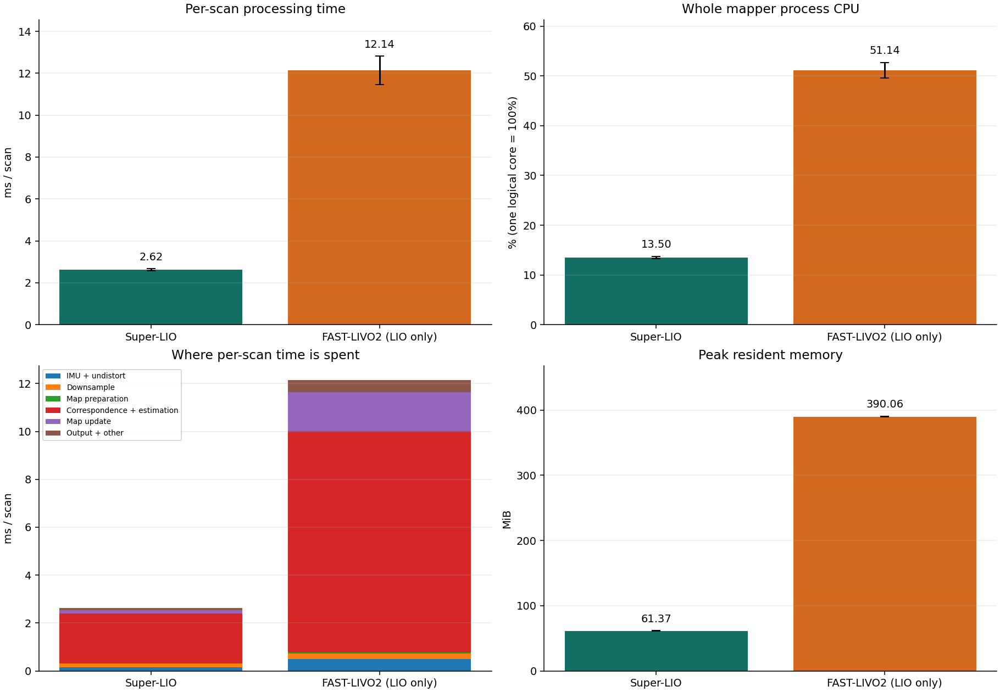
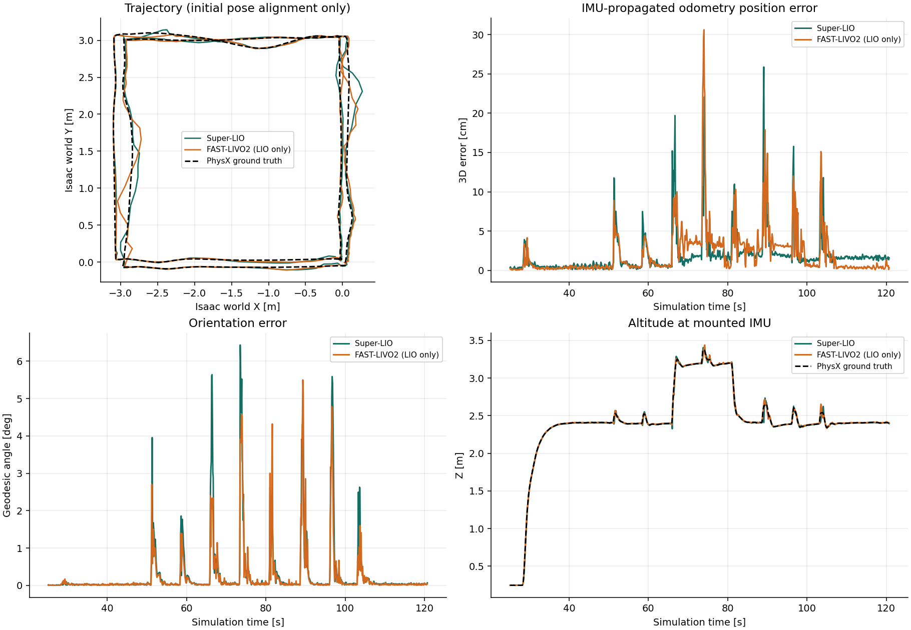
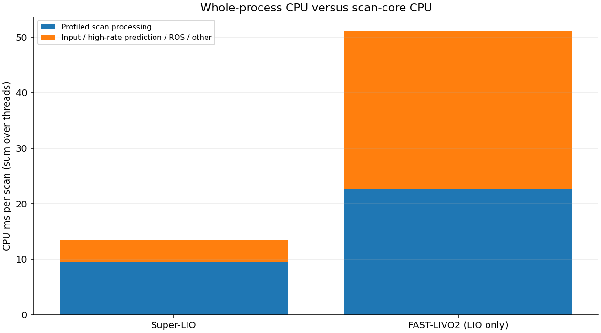
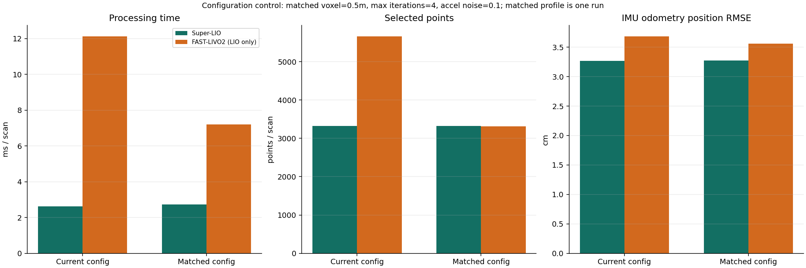
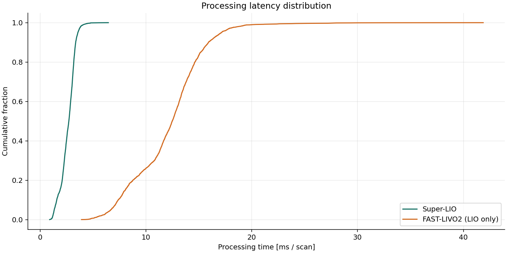

# Super-LIO / FAST-LIVO2 LIO 비교

2026-11-02, ZAV `facc1488346214dc4d0f67c6697635692b02ef7b`. FAST-LIVO2는 카메라 OFF인 LIO 모드이며 FAST-LIO2와는 다른 비교 대상이다. Super-LIO는 현재 ZAV의 IMU 재전파 수정이 포함된 버전이다.

## 현재 설정: 각 3회 평균

| 항목 | Super-LIO | FAST-LIVO2 LIO |
|---|---:|---:|
| 스캔 처리 평균 ± 회차 표준편차 | 2.62 ± 0.05 ms | 12.14 ± 0.68 ms |
| 스캔 처리 P95 | 3.56 ms | 17.05 ms |
| 프로세스 CPU | 13.50% | 51.14% |
| 최대 RSS | 61.37 MiB | 390.06 MiB |
| 처리 점 수/스캔 | 3,323 | 5,668 |
| IMU 전파 위치 RMSE | 3.26 cm | 3.69 cm |
| IMU 전파 위치 오차 P95 | 6.94 cm | 6.91 cm |
| IMU 전파 최대 위치 오차 | 25.89 cm | 30.62 cm |
| IMU 전파 자세 RMSE | 0.85° | 0.72° |
| IMU 전파 1초 상대 위치 RMSE | 4.32 cm | 4.91 cm |
| LiDAR 보정 위치 RMSE | 2.61 cm | 3.46 cm |

CPU는 논리 코어 하나의 100%를 기준으로 한다. P95는 각 회차 P95의 평균이다. 위치 RMSE는 3차원 거리 오차이며 자세 RMSE는 회전 각도 오차이다.

## 어디서 차이가 나는가

| 스캔 내부 단계 | Super-LIO ms | FAST-LIVO2 ms | 전체 시간 차이 기여 |
|---|---:|---:|---:|
| IMU 처리·왜곡 보정 | 0.150 | 0.488 | 3.55% |
| 다운샘플 | 0.170 | 0.230 | 0.63% |
| 지도 준비 | 0.000 | 0.043 | 0.45% |
| 대응점 처리·상태 추정 | 2.070 | 9.253 | 75.45% |
| 지도 갱신 | 0.142 | 1.636 | 15.70% |
| 출력·기타 | 0.085 | 0.488 | 4.23% |

현재 설정에서 스캔 처리 시간은 4.64배 차이 난다. 대응점 처리와 상태 추정은 합쳐 계측했으므로 최근접점 검색과 선형 해법의 비용을 개별적으로 분리한 결과는 아니다.

프로세스 전체 CPU에는 스캔 내부 외에도 입력 처리, 고주파 IMU 예측, ROS executor, 로깅 등이 포함된다. 잔여 CPU 비용을 특정 함수의 원인으로 단정할 수 없다. 메모리는 프로세스 전체 RSS다. FAST-LIVO2는 카메라 OFF에서도 VIOManager 초기화를 수행하므로 메모리 차이를 지도 구조만으로 설명할 수 없다.

## 설정을 맞춘 추가 실험: 각 1회

현재 FAST 설정은 다운샘플 0.1m / 최대 반복 5회이고 Super는 0.5m / 4회다. FAST도 0.5m / 4회 / 가속도 잡음 0.1로 맞춘 추가 실험을 했다. 두 알고리즘의 지도 등 모든 내부 구조가 같아지는 것은 아니다.

| 항목 | Super-LIO | FAST-LIVO2 LIO |
|---|---:|---:|
| 평균 처리 | 2.73 ms | 7.21 ms |
| 처리 점 수 | 3,323 | 3,316 |
| CPU | 13.86% | 43.20% |
| IMU 전파 위치 RMSE | 3.27 cm | 3.56 cm |

이 조건의 처리 시간 차이는 약 2.65배다. 따라서 현재 설정에서의 4.64배 차이에는 처리 점 수와 반복 횟수 차이도 포함된다. 추가 실험은 1회이므로 반복 측정에 의한 불확실성을 추정하지 않았다.

## 측정 방법과 해석 범위

- 실제 Isaac Sim 비행으로 2m 이륙, 호버, 3m 정사각형 경로 두 바퀴, 고도·yaw 변화, 착륙을 실행했다. 비행 후 착륙·disarm을 확인했다.
- 물리·IMU 200Hz, LiDAR 10Hz, 렌더 목표 설정 20Hz를 사용했다. 20Hz 실측 보장 결과는 아니다.
- 기록한 동일 IMU 25,497개와 LiDAR 1,268개를 각 알고리즘에 센서 시각 기준 1배속으로 재생했다. 모든 회차 입력이 같다. 원본 IMU에는 7.5ms 초과 간격이 3개 있었다.
- Ryzen 5 7600 / WSL2, 각 mapper에 논리 코어 4개와 병렬 스레드 최대 4개를 사용했다. 두 빌드 모두 -O3 -DNDEBUG, 카메라 및 PCD 저장 OFF. 재생 측정 중 Isaac Sim·PX4·RViz를 실행하지 않아 mapper 비용을 분리했다.
- Ground truth는 PhysX rigid-body pose를 물리 tick마다 직접 읽고 센서 장착 변환을 적용한 IMU 위치·자세다. 추정기 출력이나 렌더 단계 USD pose를 GT로 쓰지 않았다.
- 초기 정지 구간 5~15초의 위치·자세로 고정 좌표 정렬했다. 전체 경로 fitting, 축척 fitting, 시간 지연 최적화는 하지 않았다.
- 이륙부터 착륙 요청까지 약 95.75초 / 경로 27.52m를 공통 10Hz 시각에서 평가했다. 위치 선형 보간, 자세 SLERP를 사용했다. 공통 유효 범위는 현재 설정 IMU 99.79%, LiDAR 100%다.
- 주 표는 제어에 쓰이는 고주파 IMU 전파 odometry이고 각 측정 시각의 최초 발행값을 사용했다. LiDAR 보정 odometry는 별도로 집계했다.
- 그래프 궤적·오차 곡선은 대표 1회, 현재 설정 표는 3회 평균이다. 반복은 같은 데이터에 대한 실행 반복이며 독립 비행 3회가 아니다.
- 단일 환경의 짧고 느린 시뮬레이션 비행 결과다. 실환경, 장거리, 다른 센서 조건의 정확도를 보장하지 않는다. Super가 위치 RMSE는 낮지만 FAST는 자세 RMSE가 낮아 정확도가 일방적으로 우월하다고 볼 수 없다.
- 오프라인 mapper 속도 비교이므로 시뮬레이터 FPS가 4.64배 증가한다는 뜻은 아니다. 논문에 나온 Super-LIO 대 FAST-LIO2의 수치를 재현한 실험도 아니다.

원자료: `raw/`의 회차별 stages.csv, resources.jsonl, odometry.jsonl, run.json. 집계: comparison.csv, stage_comparison.csv, all_trials.csv, summary_full.csv. 입력 bag·GT·빌드 및 설정은 작업공간 `.cache/lio-comparison-20261102/`에 보관했다. 분석 스크립트는 `benchmarks/lio_compare/analyze.py`, 재생·계측 스크립트는 `benchmarks/lio_compare/replay.py`다. 제품 코드 및 물리 200Hz 설정은 변경하지 않았다.
