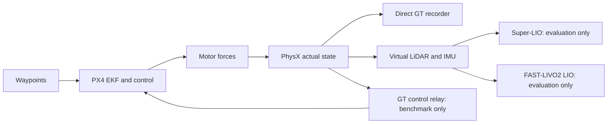
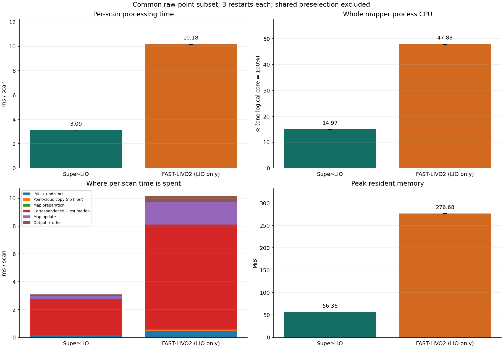
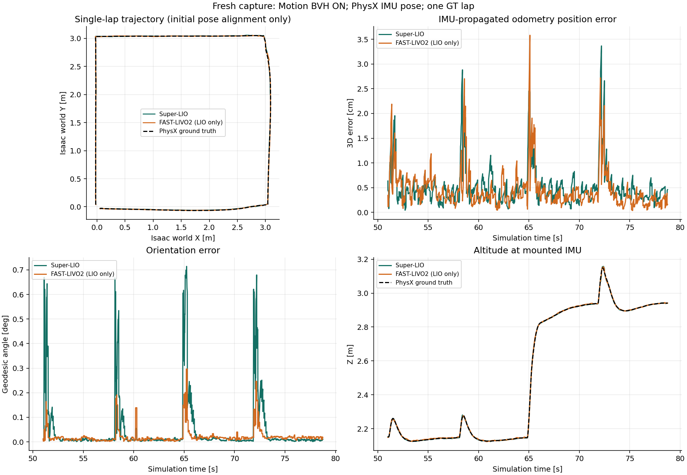
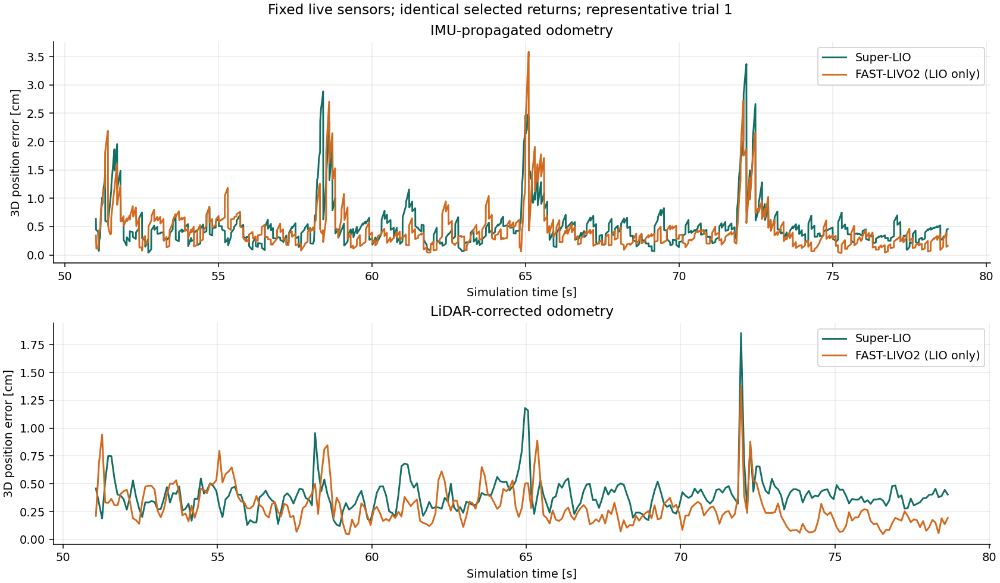

# 실시간 시간 정합 수정 후 새 비행 비교

2026-11-02. 비교 대상은 현재 ZAV의 Super-LIO와 **FAST-LIVO2 카메라 OFF LIO 모드**다. FAST-LIO2 논문 baseline을 재현한 실험이 아니다. 제품 코드를 수정하고 실제 Isaac Sim에서 새 비행을 기록한 뒤, 동일한 센서 기록·동일한 선택 포인트로 각 3회 실행했다. 이륙·정사각형 한 바퀴·고도 및 yaw 변경·착륙을 완료했고, 착륙·disarm을 확인했다.

## GT가 의미하는 값

GT는 **PhysX rigid-body의 실제 위치·자세**를 직접 읽은 값이다. EKF 출력, waypoint 보간, LIO odometry를 복사하지 않는다. 평가에서는 body pose에 실제 IMU 장착 변환을 적용해 두 알고리즘과 같은 IMU 원점을 비교한다.

일반적인 비행에서는 odom이 PX4 EKF와 제어기를 거쳐 모터에 영향을 주므로 실제 비행 경로도 odom의 영향을 받는다. 그러나 물리 엔진이 계산한 실제 상태를 별도로 읽는 GT 측정은 유효하다. 예를 들어 목표 3m, odom 3m, 실제 PhysX 위치 2.8m라면 GT는 2.8m이고 위치 추정 오차는 20cm다. 목표 경로와 실제 경로의 차이는 추정 오차와 별도의 추종 오차다.

다만 한쪽 LIO로 비행하면 그 추정기가 평가 경로를 형성한다. 이번에는 **GT 기반 제어로 경로를 만들고 두 LIO는 모두 평가용으로만 사용**했다. 측정 대상 LIO에는 GT pose를 입력하지 않았다. GT 제어는 벤치마크 실행기에만 있으며 일반 실행의 LIO→PX4 제어 설정은 유지된다.

## 새 비교 결과

| 항목 | Super-LIO | FAST-LIVO2 카메라 OFF |
|---|---:|---:|
| 처리 평균 ± 회차 표준편차 (ms) | 3.09 ± 0.04 | 10.18 ± 0.03 |
| 처리 P95 (ms) | 4.20 | 12.65 |
| 프로세스 CPU (%) | 14.97 | 47.88 |
| 최대 RSS (MiB) | 56.36 | 276.68 |
| 처리 점 수/스캔 | 5672.06 | 5672.06 |
| IMU 전파 위치 RMSE (cm) | 0.65 | 0.60 |
| IMU 전파 위치 P95 (cm) | 1.33 | 1.20 |
| IMU 전파 자세 RMSE (deg) | 0.126 | 0.049 |
| LiDAR 보정 위치 RMSE (cm) | 0.43 | 0.33 |
| LiDAR 보정 자세 RMSE (deg) | 0.029 | 0.038 |
| 원본 고주파 위치 최대 오차: 전체 회차 최댓값 (cm) | 3.37 | 4.23 |
| 원본 고주파 출력 최대 간격 (ms) | 5.00 | 40.00 |

처리 시간은 Super-LIO가 **3.30배 짧았다**. 두 알고리즘의 위치 오차는 이 경로에서 모두 cm 이하 RMSE였고, 수 mm 차이를 일반적인 정확도 우열로 확대 해석하지 않는다. 표의 기본 값은 3회 평균이다. 원본 고주파 최대 오차와 최대 발행 간격 두 행은 3회 전체의 최댓값이다. 궤적·오차 곡선은 대표 1회차다. CPU 100%는 논리 코어 하나 기준이며, P95와 최대 RSS는 각 회차 값의 평균이다.

IMU 오차는 공통 200Hz 시각에서 평가했다. LiDAR 보정 오차는 **실제 공통 스캔 끝 시각**에서 평가해 10Hz 자세를 보간하면서 생기는 오차를 섞지 않았다. 두 출력은 평가 시각이 다르므로 RMSE를 단순히 빼서 IMU 적분만의 오차로 해석할 수 없다. 각 측정 시각의 최초 발행값만 사용했다. 공통 유효 범위는 IMU 99.856%, LiDAR 100.000%다. IMU 보간은 30ms 이하 간격만 허용하며, 원본 출력 간격은 별도로 집계했다. FAST에서 계산 중 일부 고주파 발행 시각이 건너뛰는 현상은 남아 있다.

## 어디에서 연산 차이가 나는가

| 구간 | Super ms | FAST ms | 전체 시간 차이 기여 |
|---|---:|---:|---:|
| IMU + undistort | 0.151 | 0.483 | 4.7% |
| Point-cloud copy (no filter) | 0.014 | 0.058 | 0.6% |
| Map preparation | 0.000 | 0.045 | 0.6% |
| Correspondence + estimation | 2.614 | 7.518 | 69.1% |
| Map update | 0.203 | 1.638 | 20.2% |
| Output + other | 0.102 | 0.438 | 4.7% |

대응점 처리와 상태 추정은 합산 계측이며 KNN과 행렬 해법을 개별 분리한 값은 아니다. 전체 프로세스 CPU에는 고주파 IMU 예측·ROS 입력·executor 등이 포함된다. RSS는 VIO 초기화·공유 라이브러리 등도 포함한 전체 프로세스 값이다.

## 실제로 적용한 수정

1. Vehicle의 자세를 렌더용 USD 대신 위치·속도와 같은 PhysX tick에서 읽는다. IMU 좌표 변환의 약 50ms 자세 지연을 제거했다.
2. RTX XYZ는 GMO frameStart 자세 기준의 **렌더 프레임 단위 스냅샷**으로 발행한다. 해당 점에 개별 firing timestamp를 붙여 LIO가 서로 다른 시각을 혼용하던 문제를 없앴다. GT pose나 추정 pose로 XYZ를 사후 수정하지 않는다. 프레임 간 시간은 유지하고, 같은 프레임 안의 점들은 같은 시각을 갖는다. 이 모델은 실제 Mid360의 연속 rolling scan이나 비반복 패턴을 재현하지 않는다.
3. RTX Motion BVH를 켜고 NONCOMPENSATED 출력을 명시했다. **Motion BVH만 활성화해서는 해결되지 않았으므로 좌표·시각 계약도 함께 수정**했다. 원래 per-ray timestamp GPU→CPU 복사는 더 이상 사용하지 않아 제거했다.
4. FAST-LIVO2의 sparse timestamp를 임의 firing 간격으로 덮어쓰던 코드를 제거했다. 모션 보정에서 scan-start 시간과 이전 IMU update 시간을 혼용하던 원점을 통일했고, 첫 포인트도 정확히 한 번 보정한다. IMU 초기 전파 기준 시각도 명시적으로 초기화한다.
5. Super-LIO는 스캔 끝 IMU를 보간해 최대 한 IMU tick 앞선 상태에서 LiDAR 보정을 수행하던 문제를 수정했다.
6. GT topic은 200Hz physics callback에서 PhysX를 직접 읽어 발행한다. 캐시된 추정 상태를 읽지 않는 회귀 테스트를 추가했다.

제품 소스·설치 바이너리 모두 갱신했다. 물리 설정은 200Hz 그대로다. 새 비행 원본을 그대로 기록했으며, 이전 진단에서 사용한 GT-assisted IMU/deskew 개입은 이번 비교에 사용하지 않았다.

## 측정 조건·검증

- 동일 입력 반환점: 각 스캔에 공통 raw 좌표 0.5m 복셀 필터를 한 번 적용하고 실제 반환점 하나를 선택했다. 양쪽의 추가 다운샘플은 벤치마크 복사본에서만 끄고, 입력 간격 필터를 1로 맞췄다. 자체 모션 보정·지도·대응점 선택·추정기는 각 구현을 사용한다. 내부에서 유효한 매칭으로 선택하는 점 수까지 강제로 같게 만든 것은 아니다.
- 최대 반복 횟수 4회, 가속도 잡음 설정 0.1, camera 및 PCD 저장 OFF. 두 벤치마크 빌드는 -O3 -DNDEBUG, LTO·fast-math·native architecture 최적화 OFF. 각 mapper에 논리 CPU 0~3과 병렬 스레드 최대 4개를 할당했다.
- 평가 구간 51.01~78.76 simulated seconds, GT 경로 12.39m, 한 바퀴. 같은 비행을 재생한 실행 반복 3회이며 독립 비행 3회가 아니다.
- 처음부터 재생해 동일한 초기화·지도 구축 이력을 줬다. IMU 획득 시각으로 1배속 재생하고, LiDAR는 캡처에서 관측된 최신 IMU 시각과 scan-end 중 큰 값을 수신 가능 시각으로 사용해 원래 스캔 지연을 반영했다. 캡처 벽시계의 프레임별 burst 전체를 그대로 복제한 실시간 네트워크 시험은 아니다.
- 5~15초 초기 정지 pose로 고정 rigid 좌표 정렬만 수행했다. 전체 경로 fitting, scale fitting, 시간 지연 최적화는 하지 않았다.
- 원본 센서 IMU 19,287개, IMU 간격 7.5ms 초과 누락 0개. 실제 PhysX 각속도와 IMU의 월드 각속도 RMSE 2.83e-07deg/s로 자세 변환 시각 정합을 확인했다.
- ROI의 277개 스캔 각각에서 선택 점 수·입력 점 수·시각이 전 회차 공통 입력과 일치했다. 스캔당 평균 5672.06개 점. 전체 재생 입력 수와 수신 가능 스케줄도 6회 모두 동일했다. `verification.json` 참조.
- PhysX GT source, 장착 IMU 수치·샘플링, vehicle PhysX pose, snapshot packet 시간 테스트 통과. C++ Super-LIO 5개 및 FAST-LIVO2 2개 테스트 통과. FAST의 sparse 회전 보정은 알려진 회전 운동의 모든 점이 scan-end 좌표로 일치하는지 검사했다.
- 물리 200Hz·렌더 목표 20Hz다. 이번 수집의 실제 렌더 속도는 약 **13.54Hz**, real-time factor 0.677이었다. 따라서 렌더 20Hz 확보까지 해결됐다는 결과는 아니다. CPU 비교 중에는 Isaac Sim·PX4·RViz를 종료해 mapper 비용을 분리했다.

## 해석 범위

단일 창고의 짧은 시뮬레이션 경로이고 IMU noise는 0인 이상적 모델이다. 이번 센서는 렌더 단위 snapshot을 Livox-compatible packet으로 전달하므로 실제 Mid360·실제 드론·다른 경로의 정확도를 보장하지 않는다. 두 알고리즘을 각각 제어기로 연결한 비행 성능 비교도 아니다. 이전 GT 오차 표에는 잘못된 시간 정합이 섞였으므로 원래 알고리즘의 정확도 우열 판단에는 이번 수정 후 결과를 사용해야 한다.

[전체 PDF](comparison_report.pdf) · [주요 CSV](comparison.csv) · [전체 회차](all_trials.csv) · [고주파 원본 진단](high_rate_diagnostics.csv) · [단계별 비용](stage_comparison.csv) · [검증](verification.json) · [소스 해시](source_hashes.json)

재현 스크립트: `benchmarks/lio_compare/prepare_fixed.py`, `replay_fixed.py`, `analyze_fixed.py`, `verify_fixed.py`, `report_fixed.py`. 원본 bag·PhysX GT·동일 빌드 및 설정은 `.cache/lio-fixed-20261102/`에 보관했다. 탐색 중 제외한 조건은 `probe-*` 폴더에 분리했다.
